# AWS CloudFormation CI/CD Pipeline with GitHub Actions and OIDC

A Git-driven infrastructure-as-code pipeline on AWS. A CloudFormation template describes a complete small web stack: a new VPC with a public subnet, an internet gateway and routing, a security group, and an Ubuntu 24.04 EC2 instance that installs Nginx and serves a web page on first boot. Every push to `main` that changes the template or the workflow makes GitHub Actions validate the template and deploy it. The first deployment creates the stack, and every later one updates that same stack in place. GitHub signs in to AWS through OIDC with short-lived credentials, so no AWS access keys exist anywhere.

**Tech stack:** AWS CloudFormation · GitHub Actions · OpenID Connect (GitHub OIDC + AWS STS) · AWS IAM · Amazon EC2 (Ubuntu 24.04 LTS) · Amazon VPC · Nginx · AWS CLI

## Highlights

- **`git push` is the deployment.** The first push created the whole 9-resource stack in **1 minute 7 seconds** (1 m 22 s for the whole run). Nobody opened the EC2 console or clicked Launch instance.
- **No AWS access keys.** The workflow gets temporary credentials through OIDC, and they expire within an hour. The repository has no secrets at all: the role ARN and the Region are plain repository variables, because neither is a credential.
- **Trust pinned to this repository's `main` branch.** The IAM role only accepts GitHub tokens whose subject names this repository and its owner **by numeric ID**, on `main`. Another branch, a fork, or a new repository given the same name can't assume it.
- **Updates in place, with proof.** Changing one line (an EC2 tag) and pushing again updated the existing stack in **8 seconds**. The instance kept the same ID, `i-01044f72bd5b1c30f`, and nothing was created or replaced.
- **Least-privilege deploy role.** The role can validate and deploy this stack and nothing more: no IAM access, no other services, and no permission to delete stacks.
- **Small attack surface.** The server only accepts HTTP on port 80. There's no SSH port and no key pair, and the instance metadata service requires IMDSv2 tokens.
- **Fully torn down.** I disabled the workflow first, then deleted the stack, which removed all 9 resources, and then the IAM role, the policy and the OIDC provider.

Built and tested in **`us-west-2` (Oregon)** in November 2026, then fully torn down.

> **About the screenshots:** the AWS console's top bar, which shows the account name and ID, is cropped off every screenshot. The account ID inside ARNs is blacked out.

## Architecture

```text
  Developer laptop
        |
        |  git push origin main  (cloudformation.yaml or deploy.yml changed)
        v
  GitHub repository: farhanPro05/aws-cloudformation-cicd-pipeline
        |
        |  push event starts .github/workflows/deploy.yml
        v
  GitHub Actions runner (ubuntu-latest)
        |  1. check out the repository
        |  2. get a signed OIDC token from GitHub
        |  3. sts:AssumeRoleWithWebIdentity  ----->  AWS IAM: OIDC provider + deploy role
        |     <-----  temporary credentials           (trusts this repo's main branch only)
        |  4. aws cloudformation validate-template
        |  5. aws cloudformation deploy   (create or update)
        |  6. aws cloudformation describe-stacks   (print outputs)
        v
  AWS CloudFormation stack: bongodev-github-iac-dev   (us-west-2)
        |
        +--> VPC 10.42.0.0/16
        |      +--> public subnet 10.42.1.0/24 --> route table --> 0.0.0.0/0 --> internet gateway
        |      +--> security group: inbound TCP 80 only
        |
        +--> EC2 t3.micro, Ubuntu 24.04 LTS (AMI looked up from SSM), IMDSv2 required
                 |
                 |  UserData on first boot: apt-get install nginx, write index.html
                 v
           http://<public-ip>  -->  Nginx web page
```

How a push becomes infrastructure:

1. **Trigger.** A push to `main` that changes `cloudformation.yaml` or the workflow file starts [`.github/workflows/deploy.yml`](.github/workflows/deploy.yml). Pushes that only change other files, like this README or the screenshots, don't deploy anything. A concurrency group stops two deployments from running against the stack at the same time.
2. **Sign in with OIDC.** The job has the `id-token: write` permission, so it can ask GitHub for a signed OIDC token. `aws-actions/configure-aws-credentials` sends that token to AWS STS with `AssumeRoleWithWebIdentity`. IAM checks the token's issuer, audience and subject against the role's trust policy, and STS returns temporary credentials.
3. **Confirm the identity.** `aws sts get-caller-identity` prints which role the job is running as.
4. **Validate.** `aws cloudformation validate-template` rejects a broken template before anything changes.
5. **Deploy.** `aws cloudformation deploy` creates a change set and executes it. If the stack doesn't exist yet, that creates it. If it does, the change set holds only the differences. `--no-fail-on-empty-changeset` lets a run with no infrastructure changes succeed.
6. **Report.** `describe-stacks` prints the stack outputs (website URL, instance ID, public IP and VPC ID) into the run log.
7. **Bootstrap.** On its first boot, the instance runs its UserData script. The script installs Nginx with `apt-get` and writes the web page, which shows the stack's `Environment` parameter.

## Infrastructure

The stack, defined in [`cloudformation.yaml`](cloudformation.yaml):

| Resource | Logical ID | Configuration |
| --- | --- | --- |
| VPC | `DemoVPC` | `10.42.0.0/16`, DNS support and DNS hostnames on |
| Internet gateway | `InternetGateway`, `GatewayAttachment` | Attached to the VPC |
| Public subnet | `PublicSubnet` | `10.42.1.0/24`, public IPv4 address on launch |
| Routing | `PublicRouteTable`, `DefaultRoute`, `PublicRouteAssociation` | `0.0.0.0/0` → internet gateway, associated with the subnet |
| Security group | `WebSecurityGroup` | Inbound TCP 80 from anywhere, nothing else |
| EC2 instance | `UbuntuNginxServer` | `t3.micro`, Ubuntu 24.04 LTS, IMDSv2 required, Nginx installed by UserData, tags `Name`, `Environment` and `Course` |

The AMI isn't hardcoded. A parameter of type `AWS::SSM::Parameter::Value<AWS::EC2::Image::Id>` reads Canonical's public SSM parameter for the current Ubuntu 24.04 image, in whichever Region the stack is deployed to. The stack has four outputs: `WebsiteURL`, `InstanceId`, `PublicIPAddress` and `VpcId`.

Set up once, outside the stack:

| Resource | Name | Configuration |
| --- | --- | --- |
| IAM OIDC identity provider | `token.actions.githubusercontent.com` | Audience `sts.amazonaws.com` |
| IAM policy (customer managed) | `bongodev-github-iac-lab-policy` | CloudFormation deploy actions, SSM parameter read, EC2 network and instance actions |
| IAM role | `bongodev-github-iac-deploy-role` | Web identity trust for this repository's `main` branch only, maximum session 1 hour |
| GitHub repository variables | `AWS_ROLE_ARN`, `AWS_REGION` | Variables, not secrets: neither value is a credential |

## Security: OIDC and least-privilege IAM

**How GitHub signs in without keys.** GitHub runs an OIDC identity provider. When a job asks for a token, GitHub issues a short-lived token, signed by GitHub, that states exactly which repository and branch the job is running for. AWS trusts that issuer through the IAM OIDC provider, and the role's trust policy decides which tokens can become the role:

```json
"Principal": { "Federated": "arn:aws:iam::<AWS_ACCOUNT_ID>:oidc-provider/token.actions.githubusercontent.com" },
"Action": "sts:AssumeRoleWithWebIdentity",
"Condition": {
  "StringEquals": {
    "token.actions.githubusercontent.com:aud": "sts.amazonaws.com",
    "token.actions.githubusercontent.com:sub": "repo:farhanPro05@121637943/aws-cloudformation-cicd-pipeline@1466988975:ref:refs/heads/main"
  }
}
```

- **`aud`** must be `sts.amazonaws.com`, so a token issued for some other service can't be used here.
- **`sub`** must be exactly this repository on `main`, identified by the owner's and the repository's **numeric IDs** as well as their names (see [pinning numeric IDs](#the-trust-policy-pins-numeric-ids-not-only-names)). The condition uses `StringEquals`, not `StringLike`, so no wildcards are allowed.
- The credentials STS returns expire within an hour, and nothing long-lived is stored in GitHub.

**What the deploy role can do.** [`iam/deployment-policy-lab.json`](iam/deployment-policy-lab.json) allows only what deploying this stack needs:

| Service | Allowed | Why |
| --- | --- | --- |
| CloudFormation | `ValidateTemplate`, `GetTemplateSummary`, the change-set actions, `DescribeStacks`, `DescribeStackEvents` | `aws cloudformation deploy` works through change sets |
| Systems Manager | `GetParameter`, `GetParameters` | To resolve the public Ubuntu AMI parameter |
| EC2 | Create, modify and delete the VPC, subnet, internet gateway, routes and security group; `RunInstances`, `TerminateInstances`; tags | To create the resources, update them, and roll back a failed deployment |

It has **no IAM permissions**, so the workflow can't grant itself more access. It also has **no `cloudformation:DeleteStack`**: deleting the environment is a deliberate action I take with my own credentials, never something a workflow can do. The templates in [`iam/`](iam) keep the account ID and the repository IDs as placeholders; the real values only went into IAM.

---

## How I built it

### 1. AWS access: OIDC provider, deploy policy and role

The GitHub OIDC identity provider, with `sts.amazonaws.com` as its only audience. The provider applies to the whole account, but it does nothing on its own: a workflow can only use it through a role whose trust policy accepts its token.


The customer-managed deploy policy covers three services: CloudFormation, EC2 and Systems Manager.

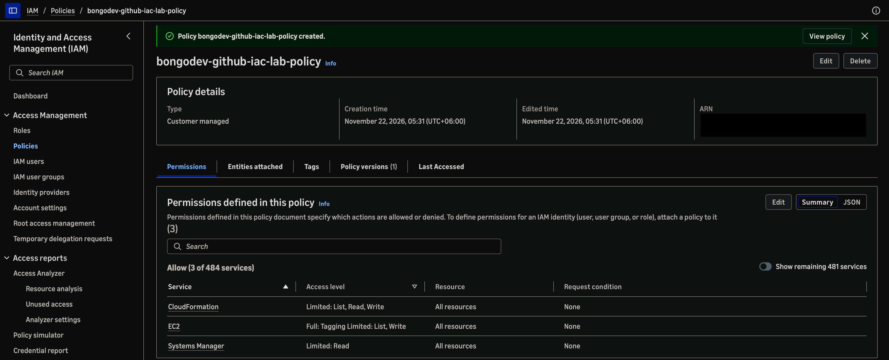

The deploy role has that one policy attached, and a maximum session duration of 1 hour.

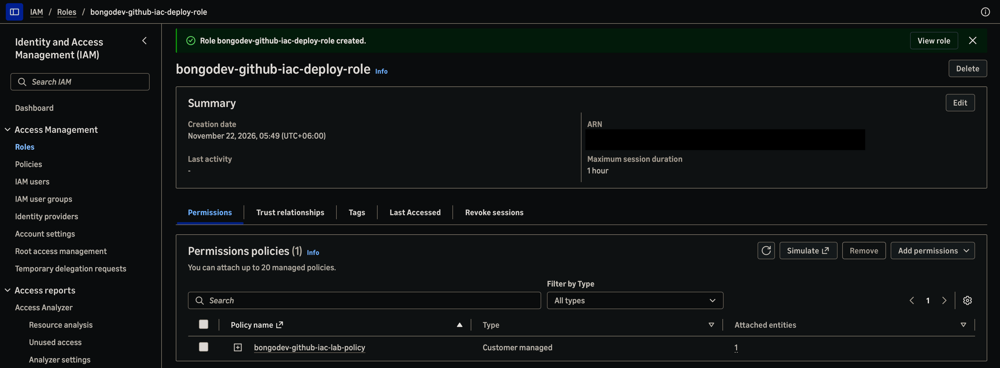

This is the role's trust policy after I replaced the one the console wizard generated. The `sub` condition names the owner and the repository by name **and** by numeric ID, and allows only the `main` branch.


The workflow reads the role ARN and the Region from repository **variables**. The repository has no secrets.


### 2. First push: the pipeline creates the stack

I committed the template and the workflow together as `Add IaC and GitHub Actions automation` and pushed to `main`. That push was the whole deployment.


Run #1 passed every step: checkout, the OIDC sign-in, the identity check, validation, deployment and outputs. Creating the stack took 1 m 7 s of the job's 1 m 18 s.

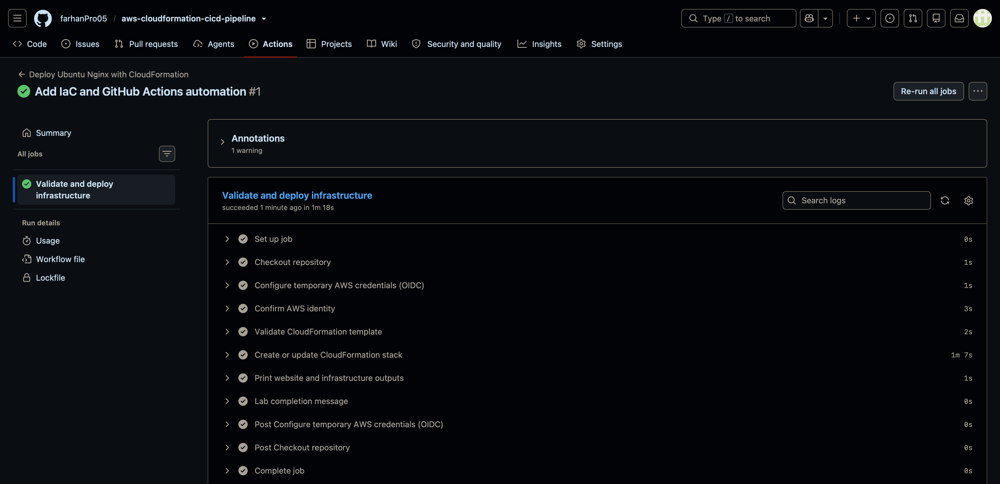

The last deploy step prints the stack outputs, so the website URL is right there in the run log.

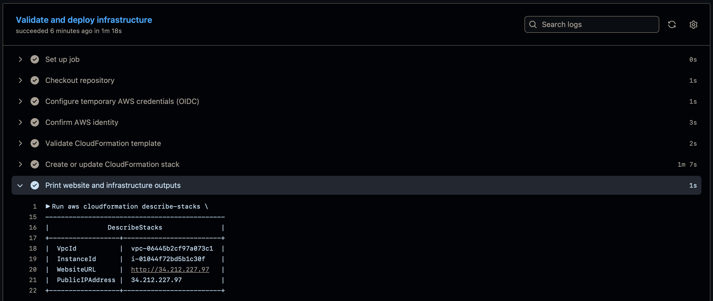

### 3. The stack in CloudFormation

Stack `bongodev-github-iac-dev` reached **CREATE_COMPLETE**, created at 06:24:20. I never clicked Create stack; the workflow created it.

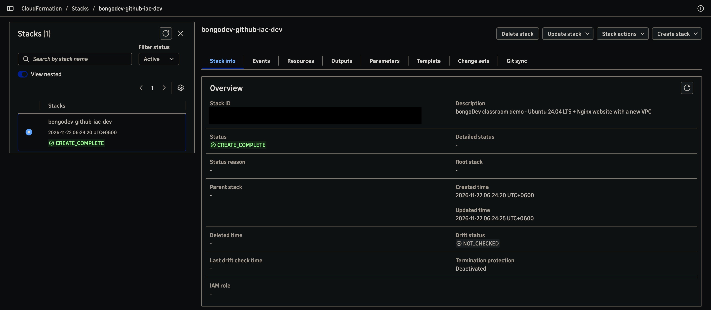

All **9 resources** in the template, each **CREATE_COMPLETE**.


The same 4 outputs the workflow printed.

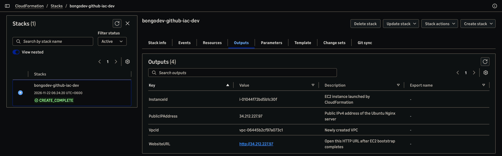

### 4. The server and the website

The instance `bongodev-github-iac-dev-dev-nginx` (`i-01044f72bd5b1c30f`) is **running** as a `t3.micro` in the stack's VPC and subnet, with IMDSv2 required.

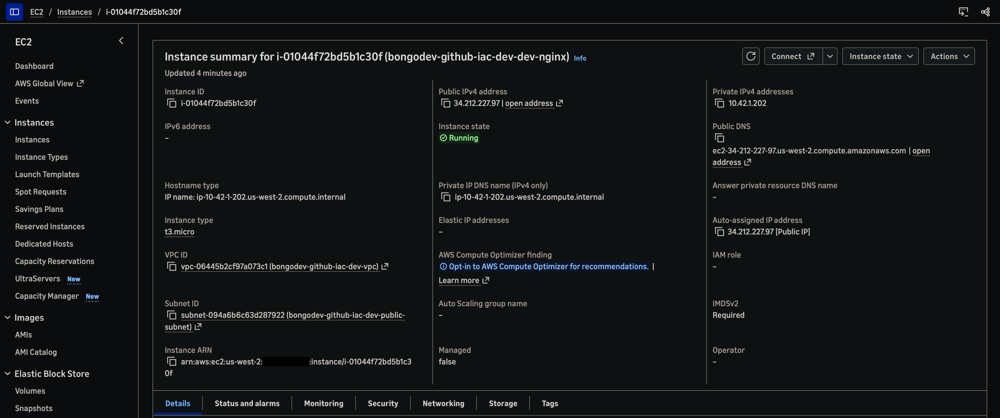

Its tags before the update: `Course` = `bongoDev-DevOps` and `Environment` = `dev`, plus its `Name` and the tags CloudFormation adds on its own.


The website, served by Nginx over plain HTTP from the instance's public IP. UserData installed and configured everything on first boot, and the `Environment: dev` line comes from the stack parameter.


### 5. Second push: an in-place update

To prove that a Git change updates the existing infrastructure, I changed one line of the template, the instance's `Course` tag, and pushed again.


Run #2 started on its own and passed in 48 seconds.


Both runs in the workflow's history, each one started by a push to `main`.

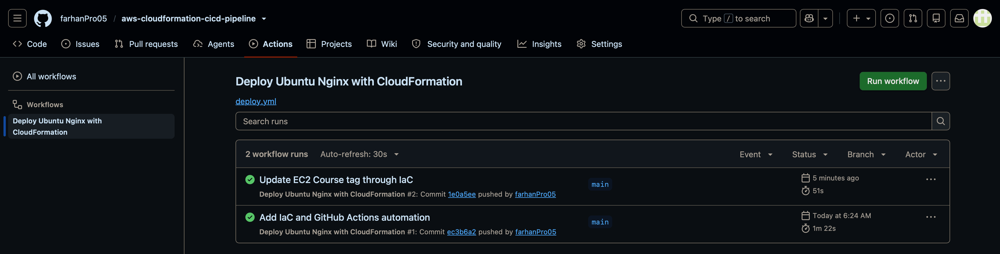

The **same stack** moved to **UPDATE_COMPLETE**. Its created time is unchanged (06:24:20), and its updated time is 08:45:46.

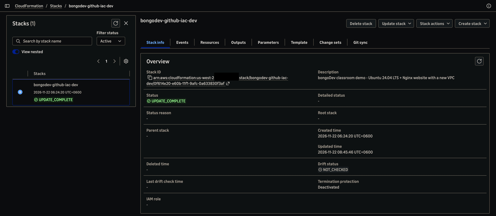

The events show exactly what the update did. Only `UbuntuNginxServer` changed: **UPDATE_IN_PROGRESS** at 08:45:48 and **UPDATE_COMPLETE** at 08:45:52. Nothing was created or replaced, and the whole stack update took 8 seconds, from 08:45:46 to 08:45:54.


After the update, `Course` reads `bongoDev-DevOps-Homework-V2` on the **same instance**, `i-01044f72bd5b1c30f` (see [why the test changes a tag](#why-the-update-test-changes-a-tag-not-the-web-page)).


### 6. Teardown

I removed everything, in an order that keeps the pipeline from recreating anything partway through.

1. **Disabled** the workflow, so no push could deploy the stack again.

   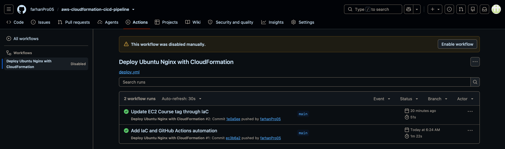

2. **Deleted** the stack in the console, with my own permissions, because the deploy role can't delete stacks. CloudFormation removed all 9 resources in dependency order.

   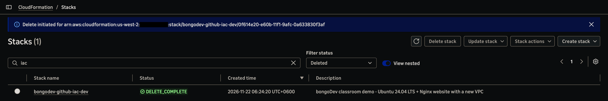

3. **Checked** that the instance was **terminated**.

   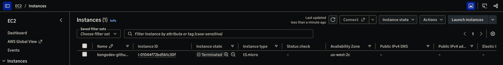

4. **Checked** that the VPC was gone.

   

5. **Deleted** the IAM role.

   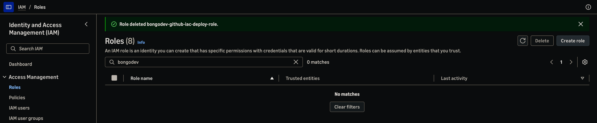

6. **Deleted** the deploy policy.

   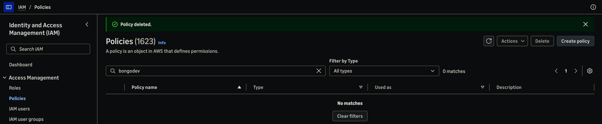

7. **Deleted** the GitHub OIDC identity provider, since nothing else in the account used it.

   

---

## Design decisions

### GitHub Actions and CloudFormation: who does what

**GitHub Actions** is the automation: it reacts to a push, runs the steps in `deploy.yml` on a fresh runner, and calls AWS with temporary credentials. **CloudFormation** is the deployment engine: it treats the template as the desired state, and creates, updates or deletes AWS resources until the stack matches it.

So the template says *what* should exist, the workflow decides *when* to apply it, and CloudFormation works out *how*: the order of operations, the dependencies between resources, and what to roll back if a step fails.

### Why a push can deploy without anyone signing in to AWS

The workflow doesn't need a person's AWS login. It signs in as the IAM role itself, with the token GitHub issues to that job (see [OIDC](#security-oidc-and-least-privilege-iam)). Everything a person would otherwise click through in the console is written in the template, so the push carries the whole change. That also makes the Git history the change log for the infrastructure: every change is a reviewed diff with an author and a time. I only used the console for the one-time IAM setup, to check the results, and for the teardown.

### Why OIDC instead of access keys

- **Nothing to leak.** Access keys stored as GitHub secrets are long-lived. Anyone who gets hold of them, through a malicious action, a leaked log or a compromised account, keeps access until someone notices and rotates them. Here, no stored credential exists to steal.
- **Short-lived.** Each job's credentials expire within an hour, and a new job has to ask again.
- **Scoped by the trust policy.** Only this repository's `main` branch can assume the role. A workflow running on another branch or in a fork presents a different subject and is refused.
- **Nothing to rotate**, and CloudTrail records every session under the role, with the session name `bongodev-iac-lab`.

### The trust policy pins numeric IDs, not only names

For repositories created since July 15, 2026, GitHub's token subject includes the owner's and the repository's numeric IDs: `repo:farhanPro05@121637943/aws-cloudformation-cicd-pipeline@1466988975:ref:refs/heads/main`.

- **The console wizard writes the old format.** The IAM role wizard generates the older name-only subject, `repo:farhanPro05/aws-cloudformation-cicd-pipeline:ref:refs/heads/main`, which never matches this repository's tokens. So I replaced the generated trust policy with one that uses the IDs, based on [`iam/trust-policy-new-repos-2026.json`](iam/trust-policy-new-repos-2026.json).
- **Names can be reused; IDs can't.** If this repository were renamed or deleted, a new repository created under the old name would get a different ID, and its tokens wouldn't match.
- [`iam/trust-policy-legacy-repos.json`](iam/trust-policy-legacy-repos.json) keeps the name-only form for repositories created before that date.

### Why a second push updates the same stack

- **The stack name is fixed.** The workflow always deploys to `bongodev-github-iac-dev`, set in `deploy.yml`. `aws cloudformation deploy` checks whether that stack exists: the first run created it, and every later run updates it.
- **Only the differences are applied.** On an update, CloudFormation compares the new template with the deployed one and builds a change set of only what changed. Resources are matched by logical ID, so `UbuntuNginxServer` in the new template *is* the running instance.
- **A tag change doesn't interrupt the instance.** CloudFormation can change an EC2 instance's tags in place, so the instance kept its ID. Changing a property such as the AMI or the subnet would **replace** the instance instead, giving a new instance with a new ID and IP.
- **No change is not a failure.** A deployment with nothing to change produces an empty change set, and `--no-fail-on-empty-changeset` makes that run succeed.

### Why `CREATE_COMPLETE` doesn't mean Nginx is ready

CloudFormation marks the instance complete once EC2 reports it **running**. The template has no `CreationPolicy`, so CloudFormation doesn't wait for anything inside the instance. The UserData script only starts at boot: it runs `apt-get update`, installs Nginx and writes the page, which takes another minute or two. Until then, the website URL in the outputs doesn't answer.

The script itself is strict: it runs with `set -euxo pipefail`, tests the Nginx configuration, checks that the service is active, and logs everything to `/var/log/bongodev-bootstrap.log`. A failed bootstrap would show up there, but the stack wouldn't know about it. In production I'd make the stack wait for the application, with a `CreationPolicy` and a `cfn-signal` sent at the end of the script, or with a load balancer health check, so that `CREATE_COMPLETE` would mean the site actually serves traffic.

### Why the update test changes a tag, not the web page

- **UserData runs once.** The script runs on the instance's first boot only. Editing the HTML in the template would change the template, but not the page on the running instance.
- **It would also disturb the instance.** Changing an instance's UserData makes CloudFormation stop and start it. The site would go down briefly and the instance would get a new public IP, and the page still wouldn't change.
- **A tag is a clean test.** It's metadata: it updates without interrupting the instance, shows up right away in the console, and makes the in-place update easy to prove by comparing the Instance ID before and after.

Real application changes belong in a deployment mechanism, such as SSM Run Command or CodeDeploy, or in replacing instances with new ones built from a new image.

### Teardown: order matters, and the pipeline can't do it

- **Disable the workflow first.** Otherwise, any later push that touches the template would quietly create the whole stack again.
- **The deploy role can't delete stacks.** Destroying the environment is a deliberate human action, not something a compromised or buggy workflow can do, so I deleted the stack in the console with my own permissions.
- **One delete removes everything.** Every resource belongs to the stack, so deleting it removed all 9 in the right dependency order. There were no orphaned subnets, gateways or security groups to hunt down.
- **Then the account-level pieces:** the role, the policy and the OIDC provider. The provider serves every repository in the account, so it should only be deleted when nothing else uses it.

### What I'd add for production

- **Review before apply.** Create the change set on a pull request and execute it only after merge, with `main` protected and a GitHub environment that requires approval for production.
- **Tighter IAM.** The deploy policy limits actions but allows them on any resource (`"Resource": "*"`). I'd scope it with resource tags and conditions, or give CloudFormation its own service role, so the GitHub role could only pass that role and manage change sets.
- **Reproducible builds.** The SSM parameter always points to the *current* Ubuntu image, so two deployments a month apart can boot different AMIs. I'd pin the AMI, or bake my own, and pin the package versions.
- **HTTPS, and no public instance.** I'd put the instance in a private subnet behind an Application Load Balancer with an ACM certificate.
- **Checks in CI.** I'd run `cfn-lint`, and a policy check such as cfn-guard, before every deployment.

---

## Repository layout

```text
.
├── README.md                     this document
├── cloudformation.yaml           the stack: VPC, subnet, routing, security group, EC2 instance with Nginx
├── .github/workflows/deploy.yml  the pipeline: OIDC sign-in, validate, deploy, print outputs
├── iam/                          IAM templates (the account ID and repository IDs are placeholders)
│   ├── deployment-policy-lab.json         the deploy role's permissions
│   ├── trust-policy-new-repos-2026.json   trust policy with numeric IDs (repositories since July 2026)
│   └── trust-policy-legacy-repos.json     trust policy with names only (older repositories)
└── screenshots/                  the console screenshots used above
```

## Notes

- **Time zone.** The times in the screenshots are local time, **UTC+6**.
- **Naming.** The AWS resource names (`bongodev-…`), the web page text and the `Course` tag values come from the starter template, and I kept them unchanged.
- **Credits.** The CloudFormation template, the GitHub Actions workflow and the IAM policy templates came from cloud-course starter files. I built and ran everything else: the GitHub repository, the OIDC trust between GitHub and AWS, the IAM setup, both deployments, the verification and the teardown.
