# AWS CloudFormation CI/CD Pipeline with GitHub Actions and OIDC

A Git-driven infrastructure-as-code pipeline on AWS. A CloudFormation template describes a complete small web stack: a new VPC with a public subnet, an internet gateway and routing, a security group, and an Ubuntu 24.04 EC2 instance that installs Nginx and serves a web page on first boot. Every push to `main` that changes the template or the workflow makes GitHub Actions validate the template and deploy it. The first deployment creates the stack, and every later one updates that same stack in place. GitHub signs in to AWS through OIDC with short-lived credentials, so no AWS access keys exist anywhere.

**Tech stack:** AWS CloudFormation · GitHub Actions · OpenID Connect (GitHub OIDC + AWS STS) · AWS IAM · Amazon EC2 (Ubuntu 24.04 LTS) · Amazon VPC · Nginx · AWS CLI

## Highlights

- **`git push` is the deployment.** The first push created the whole 9-resource stack in **1 minute 7 seconds** (1 m 22 s for the whole run). Nobody opened the EC2 console or clicked Launch instance.
- **No AWS access keys.** The workflow gets temporary credentials through OIDC, and they expire within an hour. The repository has no secrets at all: the role ARN and the Region are plain repository variables, because neither is a credential.
- **Trust pinned to this repository's `main` branch.** The IAM role only accepts GitHub tokens whose subject names this repository and its owner **by numeric ID**, on `main`. Another branch, a fork, or a new repository given the same name can't assume it.
- **Updates in place, with proof.** Changing one line (an EC2 tag) and pushing again updated the existing stack in **8 seconds**. The instance kept the same ID, `i-01044f72bd5b1c30f`, and nothing was created or replaced.
- **Least-privilege deploy role.** The role can validate and deploy this stack and nothing more: no IAM access, no other services, and no permission to delete stacks.
- **Small attack surface.** The server only accepts HTTP on port 80. There's no SSH port and no key pair, and the instance metadata service requires IMDSv2 tokens.
- **Fully torn down.** I disabled the workflow first, then deleted the stack, which removed all 9 resources, and then the IAM role, the policy and the OIDC provider.

Built and tested in **`us-west-2` (Oregon)** in November 2026, then fully torn down.

> **About the screenshots:** the AWS console's top bar, which shows the account name and ID, is cropped off every screenshot. The account ID inside ARNs is blacked out.

## Architecture

```text
  Developer laptop
        |
        |  git push origin main  (cloudformation.yaml or deploy.yml changed)
        v
  GitHub repository: farhanPro05/aws-cloudformation-cicd-pipeline
        |
        |  push event starts .github/workflows/deploy.yml
        v
  GitHub Actions runner (ubuntu-latest)
        |  1. check out the repository
        |  2. get a signed OIDC token from GitHub
        |  3. sts:AssumeRoleWithWebIdentity  ----->  AWS IAM: OIDC provider + deploy role
        |     <-----  temporary credentials           (trusts this repo's main branch only)
        |  4. aws cloudformation validate-template
        |  5. aws cloudformation deploy   (create or update)
        |  6. aws cloudformation describe-stacks   (print outputs)
        v
  AWS CloudFormation stack: bongodev-github-iac-dev   (us-west-2)
        |
        +--> VPC 10.42.0.0/16
        |      +--> public subnet 10.42.1.0/24 --> route table --> 0.0.0.0/0 --> internet gateway
        |      +--> security group: inbound TCP 80 only
        |
        +--> EC2 t3.micro, Ubuntu 24.04 LTS (AMI looked up from SSM), IMDSv2 required
                 |
                 |  UserData on first boot: apt-get install nginx, write index.html
                 v
           http://<public-ip>  -->  Nginx web page
```

How a push becomes infrastructure:

1. **Trigger.** A push to `main` that changes `cloudformation.yaml` or the workflow file starts [`.github/workflows/deploy.yml`](.github/workflows/deploy.yml). Pushes that only change other files, like this README or the screenshots, don't deploy anything. A concurrency group stops two deployments from running against the stack at the same time.
2. **Sign in with OIDC.** The job has the `id-token: write` permission, so it can ask GitHub for a signed OIDC token. `aws-actions/configure-aws-credentials` sends that token to AWS STS with `AssumeRoleWithWebIdentity`. IAM checks the token's issuer, audience and subject against the role's trust policy, and STS returns temporary credentials.
3. **Confirm the identity.** `aws sts get-caller-identity` prints which role the job is running as.
4. **Validate.** `aws cloudformation validate-template` rejects a broken template before anything changes.
5. **Deploy.** `aws cloudformation deploy` creates a change set and executes it. If the stack doesn't exist yet, that creates it. If it does, the change set holds only the differences. `--no-fail-on-empty-changeset` lets a run with no infrastructure changes succeed.
6. **Report.** `describe-stacks` prints the stack outputs (website URL, instance ID, public IP and VPC ID) into the run log.
7. **Bootstrap.** On its first boot, the instance runs its UserData script. The script installs Nginx with `apt-get` and writes the web page, which shows the stack's `Environment` parameter.

## Infrastructure

The stack, defined in [`cloudformation.yaml`](cloudformation.yaml):

| Resource | Logical ID | Configuration |
| --- | --- | --- |
| VPC | `DemoVPC` | `10.42.0.0/16`, DNS support and DNS hostnames on |
| Internet gateway | `InternetGateway`, `GatewayAttachment` | Attached to the VPC |
| Public subnet | `PublicSubnet` | `10.42.1.0/24`, public IPv4 address on launch |
| Routing | `PublicRouteTable`, `DefaultRoute`, `PublicRouteAssociation` | `0.0.0.0/0` → internet gateway, associated with the subnet |
| Security group | `WebSecurityGroup` | Inbound TCP 80 from anywhere, nothing else |
| EC2 instance | `UbuntuNginxServer` | `t3.micro`, Ubuntu 24.04 LTS, IMDSv2 required, Nginx installed by UserData, tags `Name`, `Environment` and `Course` |

The AMI isn't hardcoded. A parameter of type `AWS::SSM::Parameter::Value<AWS::EC2::Image::Id>` reads Canonical's public SSM parameter for the current Ubuntu 24.04 image, in whichever Region the stack is deployed to. The stack has four outputs: `WebsiteURL`, `InstanceId`, `PublicIPAddress` and `VpcId`.

Set up once, outside the stack:

| Resource | Name | Configuration |
| --- | --- | --- |
| IAM OIDC identity provider | `token.actions.githubusercontent.com` | Audience `sts.amazonaws.com` |
| IAM policy (customer managed) | `bongodev-github-iac-lab-policy` | CloudFormation deploy actions, SSM parameter read, EC2 network and instance actions |
| IAM role | `bongodev-github-iac-deploy-role` | Web identity trust for this repository's `main` branch only, maximum session 1 hour |
| GitHub repository variables | `AWS_ROLE_ARN`, `AWS_REGION` | Variables, not secrets: neither value is a credential |

## Security: OIDC and least-privilege IAM

**How GitHub signs in without keys.** GitHub runs an OIDC identity provider. When a job asks for a token, GitHub issues a short-lived token, signed by GitHub, that states exactly which repository and branch the job is running for. AWS trusts that issuer through the IAM OIDC provider, and the role's trust policy decides which tokens can become the role:

```json
"Principal": { "Federated": "arn:aws:iam::<AWS_ACCOUNT_ID>:oidc-provider/token.actions.githubusercontent.com" },
"Action": "sts:AssumeRoleWithWebIdentity",
"Condition": {
  "StringEquals": {
    "token.actions.githubusercontent.com:aud": "sts.amazonaws.com",
    "token.actions.githubusercontent.com:sub": "repo:farhanPro05@121637943/aws-cloudformation-cicd-pipeline@1466988975:ref:refs/heads/main"
  }
}
```

- **`aud`** must be `sts.amazonaws.com`, so a token issued for some other service can't be used here.
- **`sub`** must be exactly this repository on `main`, identified by the owner's and the repository's **numeric IDs** as well as their names (see [pinning numeric IDs](#the-trust-policy-pins-numeric-ids-not-only-names)). The condition uses `StringEquals`, not `StringLike`, so no wildcards are allowed.
- The credentials STS returns expire within an hour, and nothing long-lived is stored in GitHub.

**What the deploy role can do.** [`iam/deployment-policy-lab.json`](iam/deployment-policy-lab.json) allows only what deploying this stack needs:

| Service | Allowed | Why |
| --- | --- | --- |
| CloudFormation | `ValidateTemplate`, `GetTemplateSummary`, the change-set actions, `DescribeStacks`, `DescribeStackEvents` | `aws cloudformation deploy` works through change sets |
| Systems Manager | `GetParameter`, `GetParameters` | To resolve the public Ubuntu AMI parameter |
| EC2 | Create, modify and delete the VPC, subnet, internet gateway, routes and security group; `RunInstances`, `TerminateInstances`; tags | To create the resources, update them, and roll back a failed deployment |

It has **no IAM permissions**, so the workflow can't grant itself more access. It also has **no `cloudformation:DeleteStack`**: deleting the environment is a deliberate action I take with my own credentials, never something a workflow can do. The templates in [`iam/`](iam) keep the account ID and the repository IDs as placeholders; the real values only went into IAM.

---

## How I built it

### 1. AWS access: OIDC provider, deploy policy and role

The GitHub OIDC identity provider, with `sts.amazonaws.com` as its only audience. The provider applies to the whole account, but it does nothing on its own: a workflow can only use it through a role whose trust policy accepts its token.

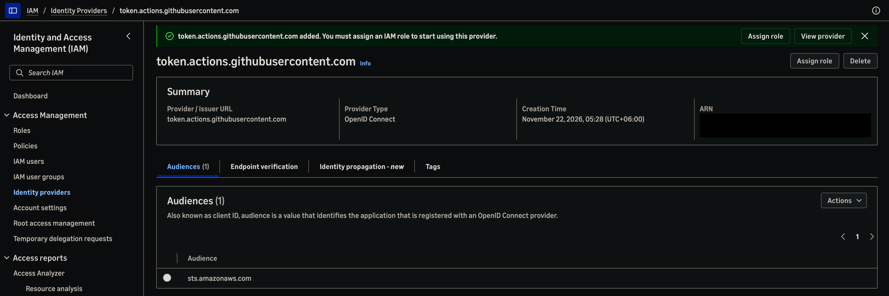

The customer-managed deploy policy covers three services: CloudFormation, EC2 and Systems Manager.


The deploy role has that one policy attached, and a maximum session duration of 1 hour.


This is the role's trust policy after I replaced the one the console wizard generated. The `sub` condition names the owner and the repository by name **and** by numeric ID, and allows only the `main` branch.

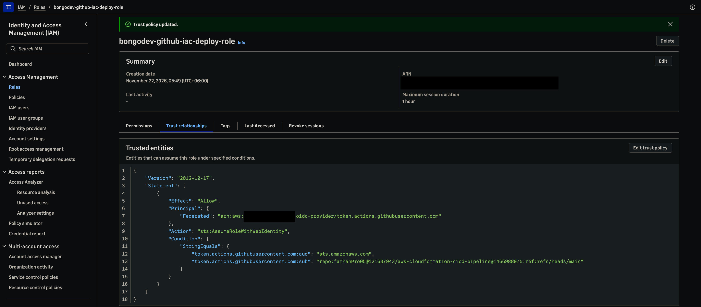

The workflow reads the role ARN and the Region from repository **variables**. The repository has no secrets.

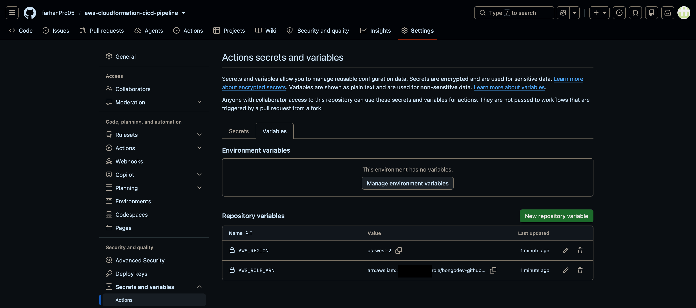

### 2. First push: the pipeline creates the stack

I committed the template and the workflow together as `Add IaC and GitHub Actions automation` and pushed to `main`. That push was the whole deployment.

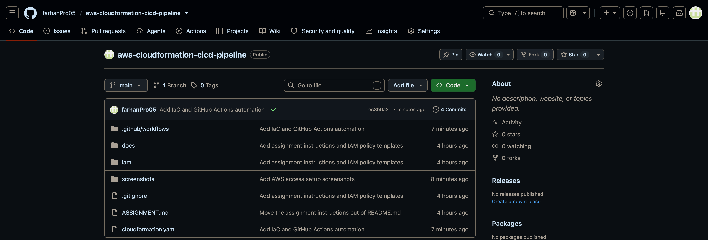

Run #1 passed every step: checkout, the OIDC sign-in, the identity check, validation, deployment and outputs. Creating the stack took 1 m 7 s of the job's 1 m 18 s.


The last deploy step prints the stack outputs, so the website URL is right there in the run log.


### 3. The stack in CloudFormation

Stack `bongodev-github-iac-dev` reached **CREATE_COMPLETE**, created at 06:24:20. I never clicked Create stack; the workflow created it.


All **9 resources** in the template, each **CREATE_COMPLETE**.

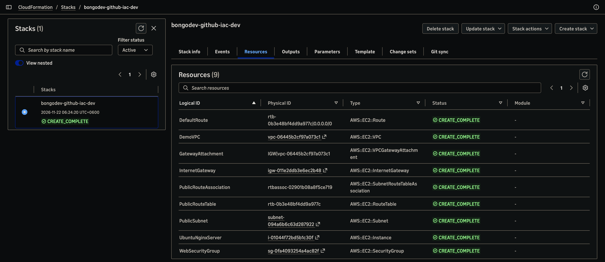

The same 4 outputs the workflow printed.


### 4. The server and the website

The instance `bongodev-github-iac-dev-dev-nginx` (`i-01044f72bd5b1c30f`) is **running** as a `t3.micro` in the stack's VPC and subnet, with IMDSv2 required.


Its tags before the update: `Course` = `bongoDev-DevOps` and `Environment` = `dev`, plus its `Name` and the tags CloudFormation adds on its own.

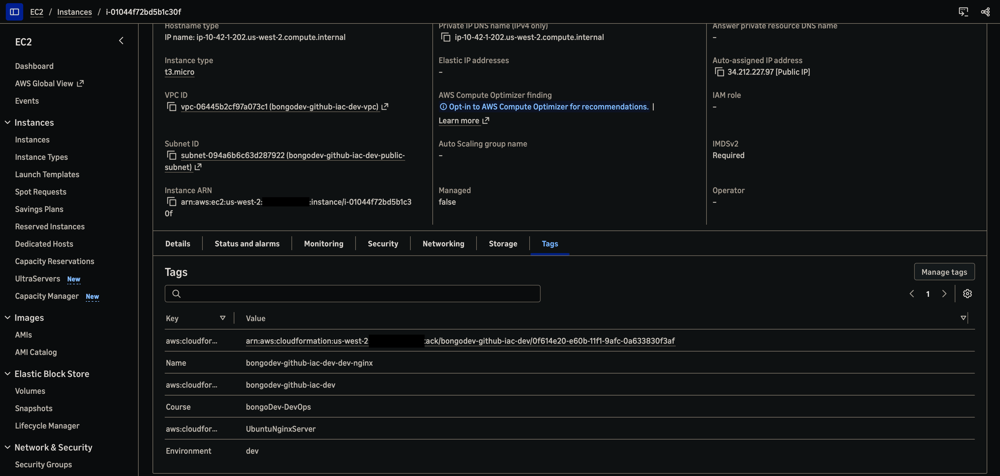

The website, served by Nginx over plain HTTP from the instance's public IP. UserData installed and configured everything on first boot, and the `Environment: dev` line comes from the stack parameter.

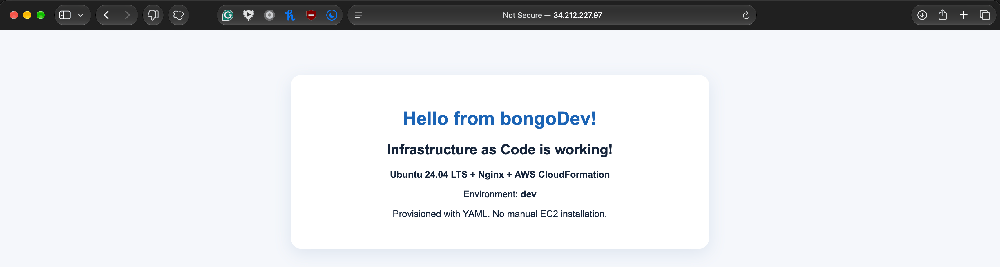

### 5. Second push: an in-place update

To prove that a Git change updates the existing infrastructure, I changed one line of the template, the instance's `Course` tag, and pushed again.

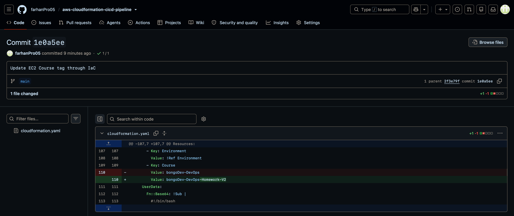

Run #2 started on its own and passed in 48 seconds.

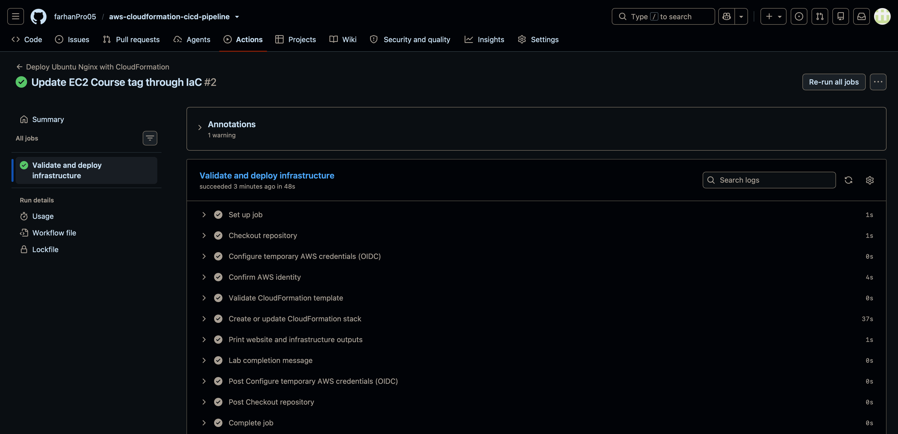

Both runs in the workflow's history, each one started by a push to `main`.


The **same stack** moved to **UPDATE_COMPLETE**. Its created time is unchanged (06:24:20), and its updated time is 08:45:46.


The events show exactly what the update did. Only `UbuntuNginxServer` changed: **UPDATE_IN_PROGRESS** at 08:45:48 and **UPDATE_COMPLETE** at 08:45:52. Nothing was created or replaced, and the whole stack update took 8 seconds, from 08:45:46 to 08:45:54.

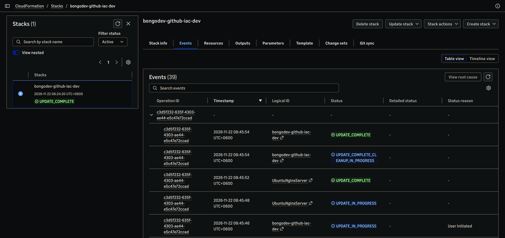

After the update, `Course` reads `bongoDev-DevOps-Homework-V2` on the **same instance**, `i-01044f72bd5b1c30f` (see [why the test changes a tag](#why-the-update-test-changes-a-tag-not-the-web-page)).

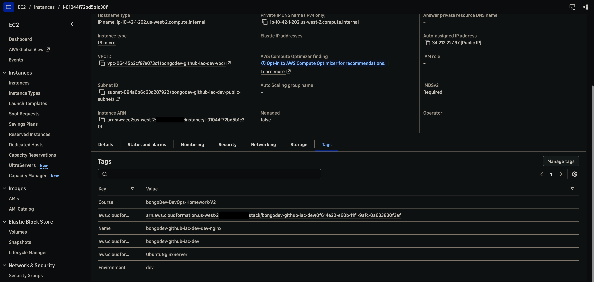

### 6. Teardown

I removed everything, in an order that keeps the pipeline from recreating anything partway through.

1. **Disabled** the workflow, so no push could deploy the stack again.

   

2. **Deleted** the stack in the console, with my own permissions, because the deploy role can't delete stacks. CloudFormation removed all 9 resources in dependency order.

   

3. **Checked** that the instance was **terminated**.

   

4. **Checked** that the VPC was gone.

   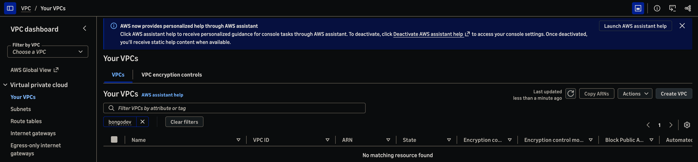

5. **Deleted** the IAM role.

   

6. **Deleted** the deploy policy.

   

7. **Deleted** the GitHub OIDC identity provider, since nothing else in the account used it.

   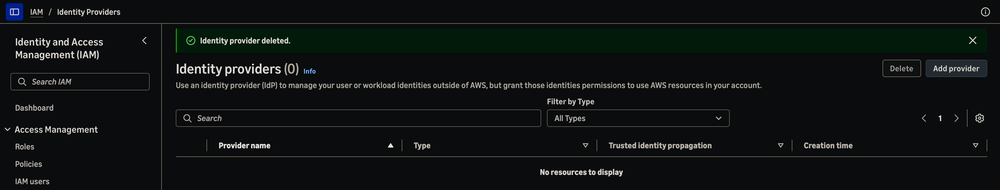
